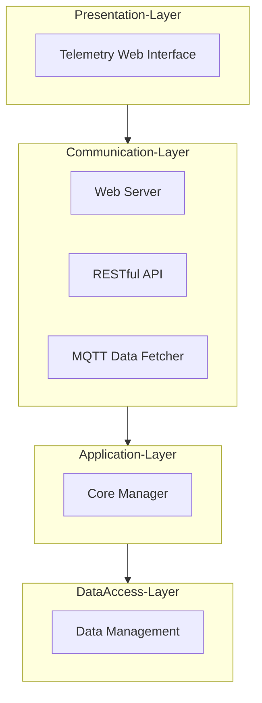
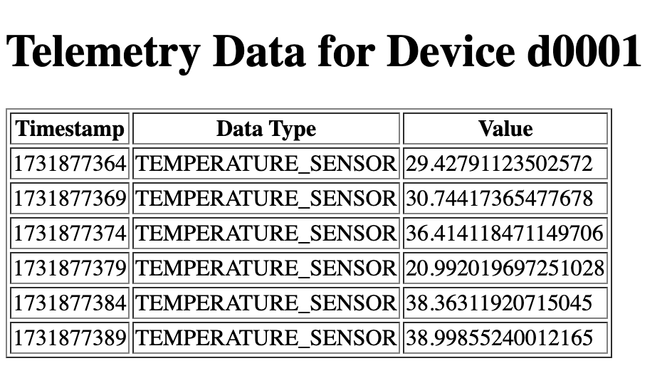
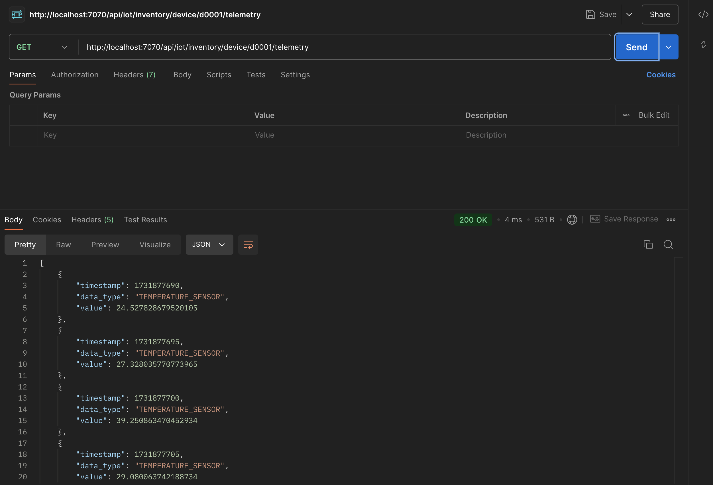

# IoT Monolithic Software Architecture - Laboratory

This project is designed as an IoT Monolithic Software Architecture Laboratory with the step by step
implementation of a simple IoT application using a monolithic architecture.
The application is structured into different modules,
each responsible for specific functionalities, ensuring modularity, scalability, and maintainability.

The architecture is divided into 4 distinct layers,
each responsible for specific functionalities, ensuring modularity,
scalability, and maintainability.

This Laboratory is a "simplified" version of the IoT Monolithic Architecture Playground
([https://github.com/Distributed-IoT-Software-Arch-Course/iot-monolithic-arch-playground](https://github.com/Distributed-IoT-Software-Arch-Course/iot-monolithic-arch-playground))
where in this case we handle only telemetry data instead of a more complex IoT architecture.

Reference Libraries: Flask & Flask-RESTful (Web Server and RESTful API) - Paho MQTT 2.x (MQTT Data Fetcher) - https://github.com/eclipse/paho.mqtt.python

## Setup

The project is managed with [uv](https://docs.astral.sh/uv/). Dependencies are declared in `pyproject.toml`,
locked in `uv.lock`, and the Python version (3.12) is pinned in `.python-version`.

- Dependencies: `flask` and `flask-restful` (Web Server and RESTful API), `paho-mqtt` 2.x (MQTT Data Fetcher and
  MQTT testers) and `pyyaml` (configuration files)

Install uv (if needed) following the [official instructions](https://docs.astral.sh/uv/getting-started/installation/), e.g.:

```bash
curl -LsSf https://astral.sh/uv/install.sh | sh
```

Then, from the project root, create the virtual environment (`.venv`) and install all the dependencies with:

```bash
uv sync
```

uv automatically downloads the required Python version if it is not available on your machine.
The command also installs the `iot_monolithic_laboratory` package (in `src/`) in editable mode, together with a
dedicated command for the application and for each tester (see [Running the Application](#running-the-application)).

In PyCharm, you can select the existing `.venv` interpreter or add a new "uv" interpreter from the interpreter settings.

### Using pip (alternative)

The `requirements.txt` file is **generated** from `uv.lock` and is kept only for pip-based workflows:

```bash
pip install -r requirements.txt
```

Do not edit it manually. After changing the dependencies, regenerate it with:

```bash
uv export --no-hashes --no-dev -o requirements.txt
```

### MQTT Broker

The MQTT Data Fetcher and the MQTT testers require a running MQTT Broker, configured in `config/mqtt_fetcher_conf.yaml`
(default: `127.0.0.1:1883` without authentication). A local [Eclipse Mosquitto](https://mosquitto.org/) broker can be
installed natively or started with Docker:

```bash
docker run -it --rm -p 1883:1883 eclipse-mosquitto:2 mosquitto -c /mosquitto-no-auth.conf
```

## n-Tier Architecture Overview

Designing an n-Tier Software Architecture for an Internet of Things (IoT)
application involves separating concerns into different layers, each responsible for specific aspects of the system.
Below is a proposed architecture that meets the specified requirements for the target Laboratory:

The idea of the architecture (using the framework [https://mermaid.js.org/](https://mermaid.js.org/)) is the following:



## System Architecture Description

The system architecture is structured into four distinct layers, each responsible for specific functionalities,
ensuring a modular and scalable design for the Internet of Things (IoT) application. The layers are as follows:

### 1. Presentation Layer
- **Web Interface**: This component provides the user interface for the system, allowing users to interact with the application through a web browser. It displays the telemetry data of the devices.

### 2. Communication Layer
- **Web Server**: Handles HTTP requests from the Web Interface and other clients. It serves static and dynamic content and manages incoming and outgoing web traffic.
- **RESTful API**: Exposes system functionalities and data through RESTful endpoints, allowing external applications to interact with the system programmatically.
- **MQTT Data Fetcher**: Manages MQTT communication, subscribing to MQTT topics to collect telemetry data from the devices.

### 3. Application Layer
- **Core Manager**: Implements the business logic of the application. It processes data received from the Communication Layer, executes core application functionalities, and manages the flow of information between different layers.

### 4. Data Access Layer
- **Data Management**: Provides an abstraction layer for data access. It handles CRUD operations (Create, Read, Update, Delete) and ensures data integrity and consistency when interacting with the underlying storage systems.

The layers are **closed**: each layer only interacts with the layer directly below it, and it only uses the data
structures defined by that layer or by itself. For this reason the Communication Layer converts the data received from
the devices (Data Transfer Objects) into the domain model of the Application Layer before handing it over.

## Project Structure

The project follows the `src` layout: all the code is in the `iot_monolithic_laboratory` package, organized in one
sub-package for each layer of the architecture.

```
iot-monolithic-arch-laboratory/
├── pyproject.toml                      # Project metadata, dependencies and entry points
├── uv.lock                             # Locked dependency versions (managed by uv)
├── requirements.txt                    # Generated from uv.lock for pip users
├── config/                             # Configuration files of the modules
│   ├── api_conf.yaml
│   ├── web_conf.yaml
│   └── mqtt_fetcher_conf.yaml
└── src/iot_monolithic_laboratory/
    ├── main.py                         # Entry point: creates the layers and starts the modules
    ├── config/                         # ConfigLoader (reads the YAML files of config/)
    ├── data/                           # Data Access Layer: DataManager
    ├── application/                    # Application Layer: CoreManager and the TelemetryModel
    ├── communication/                  # Communication Layer
    │   ├── mqtt/                       # MQTT Data Fetcher and the TelemetryMessage DTO
    │   ├── api/                        # RESTful API Server and the Telemetry Data resource
    │   └── web/                        # Web Server
    ├── presentation/                   # Presentation Layer: HTML template
    └── tester/mqtt/                    # Emulated MQTT devices and telemetry consumer
```

The project is declared in `pyproject.toml`, with its dependencies and a command for each process:

```toml
[project]
name = "iot-monolithic-arch-laboratory"
version = "0.1.0"
description = "IoT Monolithic Architecture Laboratory - n-Tier IoT application collecting and exposing the telemetry of IoT devices"
readme = "README.md"
requires-python = ">=3.10"
dependencies = [
    "flask>=2.3,<3",
    "flask-restful>=0.3.10",
    "paho-mqtt>=2.1,<3",
    "pyyaml>=6.0",
]

[project.scripts]
iot-monolith = "iot_monolithic_laboratory.main:main"
mqtt-device-producer = "iot_monolithic_laboratory.tester.mqtt.json_producer:main"
mqtt-telemetry-consumer = "iot_monolithic_laboratory.tester.mqtt.json_consumer:main"

[build-system]
requires = ["uv_build>=0.13.0,<0.14"]
build-backend = "uv_build"

[tool.uv.build-backend]
module-name = "iot_monolithic_laboratory"
```

## Implementation

The implementation starts with the creation of the different layers of the architecture proceeding in the following reverse order
with the idea of each layer to be independent and to interact with the previous layer and enable the next layer:

- Data Access Layer
- Application Layer
- Communication Layer
- Presentation Layer

All the modules are created in the `src/iot_monolithic_laboratory` package: each folder is a Python package
(with an `__init__.py` file) and the modules are imported with absolute imports starting from the package name
(e.g., `from iot_monolithic_laboratory.data.data_manager import DataManager`).

### Configuration Loader

Each module of the Communication Layer reads its parameters from a YAML file of the `config/` folder.
The `ConfigLoader` class, in the `config` package, finds the file (in the current working directory or in the project
root, so the application can be started from any folder) and merges its values over the default configuration of the
module. Create the file `config/config_loader.py` with the following content:

```python
from pathlib import Path
from typing import Any

import yaml


class ConfigLoader:
    """
    ConfigLoader class loads the YAML configuration files of the application (e.g., config/api_conf.yaml).

    A relative path is searched in the current working directory and, if not found, in the project root directory,
    so the application can be started from any folder.
    """

    # Project root directory: src/iot_monolithic_laboratory/config/config_loader.py -> 3 levels up
    PROJECT_ROOT_DIR = Path(__file__).resolve().parents[3]

    @classmethod
    def resolve_path(cls, config_file: str | Path) -> Path:
        """
        Resolve the path of a configuration file
        :param config_file: Absolute path or path relative to the working directory or to the project root
        :return: The path of the existing configuration file
        """

        config_path = Path(config_file)
        if config_path.is_absolute():
            candidate_paths = [config_path]
        else:
            candidate_paths = [Path.cwd() / config_path, cls.PROJECT_ROOT_DIR / config_path]

        for candidate_path in candidate_paths:
            if candidate_path.is_file():
                return candidate_path

        raise FileNotFoundError(f"Configuration file not found. Searched in: {[str(p) for p in candidate_paths]}")

    @classmethod
    def load(cls, config_file: str | Path, default_configuration: dict[str, Any] | None = None) -> dict[str, Any]:
        """
        Load a YAML configuration file, merging its values over the default configuration
        :param config_file: Path of the YAML file (see resolve_path)
        :param default_configuration: Default values used for the parameters not defined in the file
        :return: The configuration dictionary
        """

        configuration: dict[str, Any] = dict(default_configuration or {})

        config_path = cls.resolve_path(config_file)
        with open(config_path, "r", encoding="utf-8") as file:
            file_configuration = yaml.safe_load(file) or {}

        # Merge the file values over the defaults (one level of nested sections, e.g., "rest" or "web")
        for key, value in file_configuration.items():
            if isinstance(value, dict) and isinstance(configuration.get(key), dict):
                configuration[key] = {**configuration[key], **value}
            else:
                configuration[key] = value

        print(f"Read Configuration from file ({config_path}): {configuration}")
        return configuration
```

### Data Access Layer

The Data Access Layer is responsible for managing the data of the application and in this scenario is implemented as an in-memory data storage
storing the telemetry data for each device structured as a Dictionary where the key is the device ID and the value is a list of telemetry data.

The data handled by the application is described by a **domain model** defined by the Application Layer.
Create the folder `application/model` and add the file `telemetry_model.py` with the following content:

```python
import json


class TelemetryModel:
    """ Domain model of a telemetry measurement received from an IoT Device """

    def __init__(self, timestamp: int, data_type: str, value: float) -> None:
        self.timestamp = timestamp
        self.data_type = data_type
        self.value = value

    def to_json(self) -> str:
        return json.dumps(self, default=lambda o: o.__dict__)
```

Then create the folder `data` and add the file `data_manager.py` with the following content.
The data structure is created in the constructor, so each `DataManager` object has its own storage:

```python
from iot_monolithic_laboratory.application.model.telemetry_model import TelemetryModel


class DataManager:
    """
    DataManager class is responsible for managing the data of the application.
    Abstracts the data storage and retrieval operations.
    In this implementation everything is stored in memory.
    """

    def __init__(self) -> None:
        # Telemetry data (time series) indexed by the device id
        self.device_timeseries_data: dict[str, list[TelemetryModel]] = {}

    def add_device_telemetry_data(self, device_id: str, telemetry_data: TelemetryModel) -> None:
        """Add a new telemetry data for a given device"""
        if device_id not in self.device_timeseries_data:
            self.device_timeseries_data[device_id] = []
        self.device_timeseries_data[device_id].append(telemetry_data)

    def get_telemetry_data_by_device_id(self, device_id: str) -> list[TelemetryModel] | None:
        """Return the telemetry data for a given device (None if the device has never sent data)"""
        return self.device_timeseries_data.get(device_id)
```

### Application Layer

In this simplified implementation version the core module wraps the data access layer and provides the core functionalities of the application.
The idea is to decouple the data access layer from the application layer and provide a more modular and scalable design.
This additional layer allows for easier testing and maintenance of the application and the introduction of new functionalities
without affecting the data access layer.

The Application Layer works only with its own domain model (`TelemetryModel`): it does not know how the data has been
received (e.g., through MQTT or HTTP). In the `application` folder add the file `core_manager.py` with the following content:

```python
from iot_monolithic_laboratory.application.model.telemetry_model import TelemetryModel
from iot_monolithic_laboratory.data.data_manager import DataManager


class CoreManager:
    """
    Core Manager class that handles the core functionality of the application
    Main methods re-call the data manager methods to decouple the core functionality from the data management
    Additional dedicated methods are used to handle telemetry data from devices with a specific application logic
    """

    def __init__(self, data_manager: DataManager) -> None:
        """Initialize the CoreManager with a Data Manager"""
        self.data_manager = data_manager

    def handle_device_telemetry_data(self, device_id: str, telemetry_data: TelemetryModel) -> None:
        """ Handle telemetry data received from a device """

        # Check that the telemetry data is valid
        if telemetry_data is None or not isinstance(telemetry_data, TelemetryModel):
            raise ValueError("Invalid Telemetry Data")

        self.data_manager.add_device_telemetry_data(device_id, telemetry_data)
        print(f'Telemetry data received from device {device_id}')

    def get_telemetry_data_by_device_id(self, device_id: str) -> list[TelemetryModel] | None:
        """
        Get telemetry data by device id from data manager
        :param device_id: Device id associated with telemetry data
        :return: List of telemetry data
        """
        return self.data_manager.get_telemetry_data_by_device_id(device_id)
```

### Communication Layer

The Communication Layer is responsible for handling incoming requests from clients, exposing system functionalities through RESTful API endpoints,
fetching data from IoT devices using MQTT, and serving the web interface to users.
Each module runs in a dedicated thread, so the three modules work in parallel inside the same process.

#### MQTT Data Fetcher

The telemetry messages published by the devices are JSON payloads with the following structure:

```json
{"timestamp": 1731877690, "data_type": "TEMPERATURE_SENSOR", "value": 24.527828679520105}
```

The payload is mapped by a **Data Transfer Object** (DTO) of the Communication Layer.
Create the folder `communication/mqtt/dto` and add the file `telemetry_message.py` with the following content:

```python
import json


class TelemetryMessage:
    """
    Telemetry Message DTO class mapping the JSON payload of the MQTT telemetry messages:
    - timestamp: timestamp of the telemetry message
    - data_type: type of the telemetry message
    - value: value of the telemetry message
    """

    def __init__(self, timestamp: int, data_type: str, value: float) -> None:
        self.timestamp = timestamp
        self.data_type = data_type
        self.value = value

    def to_json(self) -> str:
        return json.dumps(self, default=lambda o: o.__dict__)
```

In the folder `communication/mqtt` add the file `mqtt_data_fetcher.py`. The MQTT Data Fetcher is in charge of fetching
data from the MQTT Broker using the Paho MQTT library (2.x):

- the constructor reads the configuration and creates the MQTT client. Paho 2.x requires the **Callback API version**
  (`mqtt.CallbackAPIVersion.VERSION2`), that defines the signature of the callbacks;
- `on_connect` subscribes to the telemetry topic only after a **successful connection**. Since it is called again at
  each automatic reconnection, the subscription is renewed if the connection with the broker is lost;
- `on_message` extracts the device id from the topic, deserializes the payload into the `TelemetryMessage` DTO,
  converts it into the `TelemetryModel` of the Application Layer and calls the Core Manager;
- `start()` uses `connect_async()` and `loop_start()`: the Paho network loop runs in its own background thread and
  keeps retrying the connection if the broker is not available yet, without blocking the other modules;
- `stop()` disconnects from the broker and stops the network loop.

```python
import json
from typing import Any

import paho.mqtt.client as mqtt
from paho.mqtt.properties import Properties
from paho.mqtt.reasoncodes import ReasonCode

from iot_monolithic_laboratory.application.core_manager import CoreManager
from iot_monolithic_laboratory.application.model.telemetry_model import TelemetryModel
from iot_monolithic_laboratory.communication.mqtt.dto.telemetry_message import TelemetryMessage
from iot_monolithic_laboratory.config.config_loader import ConfigLoader


class MqttDataFetcher:
    """
    MQTT Data Fetcher of the Communication Layer: it subscribes to the telemetry topic of the devices and forwards
    the received data to the Application Layer.
    The Paho network loop runs in its own thread (loop_start), so the fetcher does not block the other modules.
    """

    # Default configuration, used for the parameters not defined in the configuration file
    DEFAULT_CONFIGURATION: dict[str, Any] = {
        "broker_ip": "127.0.0.1",
        "broker_port": 1883,
        "client_id": "iot-monolithic-laboratory-fetcher",
        "target_telemetry_topic": "device/+/temperature",
        "username": None,
        "password": None
    }

    def __init__(self, config_file: str, core_manager: CoreManager) -> None:

        # Core Manager of the Application Layer
        self.core_manager = core_manager

        # Read the configuration from the target configuration file
        self.configuration_dict = ConfigLoader.load(config_file, self.DEFAULT_CONFIGURATION)

        # MQTT Broker Configuration
        self.mqtt_broker_host: str = self.configuration_dict["broker_ip"]
        self.mqtt_broker_port: int = self.configuration_dict["broker_port"]
        self.mqtt_topic: str = self.configuration_dict["target_telemetry_topic"]
        self.mqtt_username: str | None = self.configuration_dict["username"]
        self.mqtt_password: str | None = self.configuration_dict["password"]

        # Create the MQTT client (Paho 2.x requires the Callback API version)
        self.client = mqtt.Client(mqtt.CallbackAPIVersion.VERSION2, self.configuration_dict["client_id"])
        self.client.on_connect = self.on_connect
        self.client.on_disconnect = self.on_disconnect
        self.client.on_message = self.on_message

    def on_connect(self, client: mqtt.Client, userdata: Any, flags: mqtt.ConnectFlags,
                   reason_code: ReasonCode, properties: Properties | None) -> None:
        """ Callback for the CONNACK response of the broker: subscribe only after a successful connection.
        It is called again at each automatic reconnection, renewing the subscription """

        if reason_code.is_failure:
            print(f"MQTT Data Fetcher - Connection refused: {reason_code}")
            return

        print(f"MQTT Data Fetcher - Connected to {self.mqtt_broker_host}:{self.mqtt_broker_port} ({reason_code})")
        client.subscribe(self.mqtt_topic)
        print(f"MQTT Data Fetcher - Subscribed to topic: {self.mqtt_topic}")

    def on_disconnect(self, client: mqtt.Client, userdata: Any, flags: mqtt.DisconnectFlags,
                      reason_code: ReasonCode, properties: Properties | None) -> None:
        """ Callback for the disconnection from the broker (Paho reconnects automatically) """
        print(f"MQTT Data Fetcher - Disconnected: {reason_code}")

    def on_message(self, client: mqtt.Client, userdata: Any, message: mqtt.MQTTMessage) -> None:
        """ Callback for the received messages: deserialize the telemetry and forward it to the Application Layer """

        if not mqtt.topic_matches_sub(self.mqtt_topic, message.topic):
            return

        try:
            payload = message.payload.decode("utf-8")

            # Extract the device ID from the topic (device/<device_id>/temperature)
            device_id = message.topic.split('/')[1]

            # Deserialize the payload into the TelemetryMessage DTO
            telemetry_message = TelemetryMessage(**json.loads(payload))
            print(f"MQTT Data Fetcher - Received message from device {device_id}: {payload}")

            # Convert the DTO into the domain model of the Application Layer and handle it
            telemetry_model = TelemetryModel(telemetry_message.timestamp,
                                             telemetry_message.data_type,
                                             telemetry_message.value)
            self.core_manager.handle_device_telemetry_data(device_id, telemetry_model)

        except Exception as e:
            print(f"MQTT Data Fetcher - Error processing message on {message.topic}: {e}")

    def start(self) -> None:
        """ Connect to the MQTT Broker and start the Paho network loop in a background thread """

        # Set the credentials only if they are configured
        if self.mqtt_username and self.mqtt_password:
            print("MQTT Data Fetcher - Setting username and password ...")
            self.client.username_pw_set(self.mqtt_username, self.mqtt_password)

        # connect_async() does not block: the connection (and the retries if the broker is not available yet)
        # are managed by the network loop started by loop_start()
        print(f"MQTT Data Fetcher - Connecting to {self.mqtt_broker_host}:{self.mqtt_broker_port} ...")
        self.client.connect_async(self.mqtt_broker_host, self.mqtt_broker_port, 60)
        self.client.loop_start()

    def stop(self) -> None:
        """ Disconnect from the MQTT Broker and stop the network loop """
        self.client.disconnect()
        self.client.loop_stop()
        print("MQTT Data Fetcher stopped")
```

The MQTT Data Fetcher reads the MQTT Broker configuration, the client id and the optional username/password from a
configuration file. Create the `config` folder in the project root and add the file `mqtt_fetcher_conf.yaml` with the
following content:

```yaml
# MQTT Data Fetcher configuration
broker_ip: "127.0.0.1"
broker_port: 1883
# Unique MQTT client id of the fetcher
client_id: "iot-monolithic-laboratory-fetcher"
# Optional credentials (null if the broker does not require authentication)
username: null
password: null
# Topic filter of the device telemetry (device/<device_id>/temperature)
target_telemetry_topic: "device/+/temperature"
```

#### HTTP API Server

The HTTP API Server (based on Flask-RESTful) is responsible for exposing RESTful API endpoints to interact with the system programmatically.
In this simple implementation, we will create a single endpoint to read telemetry data from an IoT device.

Create the folder `communication/api/resources` and add the file `telemetry_data_resource.py` representing the RESTful
Telemetry Data Resource with the following content:

```python
from typing import Any

from flask_restful import Resource

from iot_monolithic_laboratory.application.core_manager import CoreManager


class TelemetryDataResource(Resource):
    """Resource to handle the Telemetry Data of a specific Device"""

    def __init__(self, **kwargs: Any) -> None:
        # Inject the CoreManager instance
        self.core_manager: CoreManager = kwargs['core_manager']

    def get(self, device_id: str) -> Any:
        """GET Request to retrieve the Telemetry Data of a target device"""

        device_telemetry_data = self.core_manager.get_telemetry_data_by_device_id(device_id)

        if device_telemetry_data is None:
            return {'error': "Device Not Found !"}, 404

        # Build a serializable list transforming each telemetry data into a dictionary:
        # Flask-RESTful then serializes it into JSON
        telemetry_data_list = [telemetry_data.__dict__ for telemetry_data in device_telemetry_data]

        return telemetry_data_list, 200
```

Then create the HTTP API Server in the `communication/api` folder with the file `rest_api_server.py`.
The class registers the resource on the configured prefix and runs the HTTP server in a separate thread.
The server is created with `make_server()` of Werkzeug (the WSGI library used by Flask): differently from
`app.run()`, the returned server object provides a `shutdown()` method, used by `stop()` to terminate the server
cleanly when the application is stopped.

```python
import threading
from typing import Any

from flask import Flask
from flask_restful import Api
from werkzeug.serving import BaseWSGIServer, make_server

from iot_monolithic_laboratory.application.core_manager import CoreManager
from iot_monolithic_laboratory.communication.api.resources.telemetry_data_resource import TelemetryDataResource
from iot_monolithic_laboratory.config.config_loader import ConfigLoader


class RestApiServer:
    """
    RESTful API Server exposing the telemetry data collected from the IoT devices.
    The HTTP server runs in a dedicated thread, so it can be executed together with the other modules of the monolith.
    """

    # Default configuration, used for the parameters not defined in the configuration file
    DEFAULT_CONFIGURATION: dict[str, Any] = {
        "rest": {
            "api_prefix": "/api/iot/inventory",
            "host": "0.0.0.0",
            "port": 7070
        }
    }

    def __init__(self, config_file: str, core_manager: CoreManager) -> None:

        # Core Manager of the Application Layer (the only layer the Communication Layer interacts with)
        self.core_manager = core_manager

        # Read the configuration from the target configuration file
        self.configuration_dict = ConfigLoader.load(config_file, self.DEFAULT_CONFIGURATION)

        # HTTP server and its thread (created by start())
        self.http_server: BaseWSGIServer | None = None
        self.server_thread: threading.Thread | None = None

        # Initialize the Flask application and the REST API
        self.app = Flask(__name__)
        self.api = Api(self.app)
        self.init_rest_api()

    def init_rest_api(self) -> None:
        """ Initialize the REST API with resources and endpoints """

        api_prefix = self.configuration_dict['rest']['api_prefix']

        # Telemetry Data of a specific device
        self.api.add_resource(TelemetryDataResource, api_prefix + '/device/<string:device_id>/telemetry',
                              resource_class_kwargs={'core_manager': self.core_manager},
                              endpoint="device_telemetry_data",
                              methods=['GET'])

    def start(self) -> None:
        """ Start the REST API Server in a dedicated thread """

        host = self.configuration_dict['rest']['host']
        port = self.configuration_dict['rest']['port']

        # make_server() binds the socket immediately: an error (e.g., port already in use) is raised here
        self.http_server = make_server(host, port, self.app, threaded=True)
        self.server_thread = threading.Thread(target=self.http_server.serve_forever, name="rest-api-server", daemon=True)
        self.server_thread.start()

        print(f"RESTful API Server running on http://{host}:{port}{self.configuration_dict['rest']['api_prefix']}")

    def stop(self) -> None:
        """ Stop the REST API Server and wait for its thread """
        if self.http_server is not None:
            self.http_server.shutdown()
        if self.server_thread is not None:
            self.server_thread.join()
        print("RESTful API Server stopped")
```

As already done for the MQTT Data Fetcher, the REST API Server uses a configuration file.
Add the file `api_conf.yaml` in the `config` folder with the following content:

```yaml
# RESTful API Server configuration
rest:
  api_prefix: "/api/iot/inventory"
  host: "0.0.0.0"
  port: 7070
```

#### Web Server

The Web Server is responsible for serving the web interface to users, handling incoming HTTP requests, and rendering the web pages.
We use Flask to create a simple web server that serves dynamic content to users through the templates
of the Presentation Layer.

Create the folder `communication/web` and add the file `web_server.py` with the following content. The structure is the
same of the REST API Server, while the `telemetry()` method retrieves the telemetry data from the Core Manager and
renders the `telemetry.html` template:

```python
import threading
from pathlib import Path
from typing import Any

from flask import Flask, render_template
from werkzeug.serving import BaseWSGIServer, make_server

from iot_monolithic_laboratory.application.core_manager import CoreManager
from iot_monolithic_laboratory.config.config_loader import ConfigLoader

# Folder of the Presentation Layer templates: src/iot_monolithic_laboratory/presentation
TEMPLATE_DIR = Path(__file__).resolve().parents[2] / "presentation"


class WebServer:
    """
    Web Server of the Communication Layer: it renders the HTML templates of the Presentation Layer
    with the data provided by the Application Layer. The HTTP server runs in a dedicated thread.
    """

    # Default configuration, used for the parameters not defined in the configuration file
    DEFAULT_CONFIGURATION: dict[str, Any] = {
        "web": {
            "host": "0.0.0.0",
            "port": 7071
        }
    }

    def __init__(self, config_file: str, core_manager: CoreManager) -> None:

        # Core Manager of the Application Layer
        self.core_manager = core_manager

        # Read the configuration from the target configuration file
        self.configuration_dict = ConfigLoader.load(config_file, self.DEFAULT_CONFIGURATION)

        # HTTP server and its thread (created by start())
        self.http_server: BaseWSGIServer | None = None
        self.server_thread: threading.Thread | None = None

        # Create the Flask app using the templates of the Presentation Layer
        self.app = Flask(__name__, template_folder=str(TEMPLATE_DIR))

        # Add URL rules to the Flask app mapping the URL to the function
        self.app.add_url_rule('/device/<string:device_id>/telemetry', 'telemetry', self.telemetry)

    def telemetry(self, device_id: str) -> str:
        """ Get telemetry data for a specific device and render the telemetry.html template"""
        telemetry_data = self.core_manager.get_telemetry_data_by_device_id(device_id)
        return render_template('telemetry.html', telemetry_data=telemetry_data, device_id=device_id)

    def start(self) -> None:
        """ Start the Web Server in a dedicated thread """

        host = self.configuration_dict['web']['host']
        port = self.configuration_dict['web']['port']

        # make_server() binds the socket immediately: an error (e.g., port already in use) is raised here
        self.http_server = make_server(host, port, self.app, threaded=True)
        self.server_thread = threading.Thread(target=self.http_server.serve_forever, name="web-server", daemon=True)
        self.server_thread.start()

        print(f"Web Server running on http://{host}:{port}/device/<device_id>/telemetry")

    def stop(self) -> None:
        """ Stop the Web Server and wait for its thread """
        if self.http_server is not None:
            self.http_server.shutdown()
        if self.server_thread is not None:
            self.server_thread.join()
        print("Web Server stopped")
```

Add the file `web_conf.yaml` in the `config` folder with the following content:

```yaml
# Web Server configuration
web:
  host: "0.0.0.0"
  port: 7071
```

### Presentation Layer

In this example, the Presentation Layer is represented by a simple web interface that using Flask web templates
renders the data received from the Application Layer (for additional info you can visit: [https://flask.palletsprojects.com/en/stable/tutorial/templates/](https://flask.palletsprojects.com/en/stable/tutorial/templates/)). The web interface is focused only on the visualization of
the telemetry data of a target device identified through the device ID and specified in the URL.
Flask templates use the Jinja2 template engine to render dynamic content in the web pages.
Some examples are available at the following link: [https://jinja.palletsprojects.com/en/stable/templates/](https://jinja.palletsprojects.com/en/stable/templates/).

Create the folder `presentation` in the package and add the file `telemetry.html` with the following content:

```html
<!DOCTYPE html>
<html lang="en">
<head>
    <meta charset="UTF-8">
    <title>Telemetry Data for Device {{ device_id }}</title>
</head>
<body>
    <h1>Telemetry Data for Device {{ device_id }}</h1>
    
    <table border="1">
        <tr>
            <th>Timestamp</th>
            <th>Data Type</th>
            <th>Value</th>
        </tr>
        
        <tr>
            <td>{{ telemetry.timestamp }}</td>
            <td>{{ telemetry.data_type }}</td>
            <td>{{ telemetry.value }}</td>
        </tr>
        
    </table>
    
    <p>No telemetry data available for this device.</p>
    
</body>
</html>
```

### Main Application

The main application orchestrates the interactions between different layers of the system, creating the layers from
the bottom to the top and starting the threads of the Communication Layer components. The main thread then waits
until the application is stopped with `CTRL+C`, and stops all the modules.

Create the file `main.py` in the package with the following content:

```python
# Entry point of the IoT Monolithic Application. From the project root run: uv run iot-monolith
#
# The monolith is a single process that creates the layers of the n-Tier architecture from the bottom to the top:
# Data Access Layer (DataManager) -> Application Layer (CoreManager) -> Communication Layer (RestApiServer,
# WebServer, MqttDataFetcher). The three modules of the Communication Layer run in parallel in dedicated threads.

import threading

from iot_monolithic_laboratory.application.core_manager import CoreManager
from iot_monolithic_laboratory.communication.api.rest_api_server import RestApiServer
from iot_monolithic_laboratory.communication.mqtt.mqtt_data_fetcher import MqttDataFetcher
from iot_monolithic_laboratory.communication.web.web_server import WebServer
from iot_monolithic_laboratory.data.data_manager import DataManager

# Configuration files (relative to the project root or to the working directory)
API_CONFIG_FILE = "config/api_conf.yaml"
WEB_CONFIG_FILE = "config/web_conf.yaml"
MQTT_CONFIG_FILE = "config/mqtt_fetcher_conf.yaml"


def main() -> None:

    # Data Access Layer: Data Manager initialization
    data_manager = DataManager()

    # Application Layer: Core Manager with the Data Manager reference
    core_manager = CoreManager(data_manager)

    # Communication Layer: RESTful API Server, Web Server and MQTT Data Fetcher
    rest_api_server = RestApiServer(API_CONFIG_FILE, core_manager)
    web_server = WebServer(WEB_CONFIG_FILE, core_manager)
    mqtt_data_fetcher = MqttDataFetcher(MQTT_CONFIG_FILE, core_manager)

    # Start the modules of the Communication Layer, each one in its own thread
    rest_api_server.start()
    web_server.start()
    mqtt_data_fetcher.start()

    print("IoT Monolithic Application running (CTRL+C to stop)")

    try:
        # Keep the main thread alive while the modules are running
        threading.Event().wait()
    except KeyboardInterrupt:
        print("Stopping the IoT Monolithic Application ...")
    finally:
        mqtt_data_fetcher.stop()
        web_server.stop()
        rest_api_server.stop()


if __name__ == "__main__":
    main()
```

The `main()` function is exposed as the `iot-monolith` command in the `[project.scripts]` section of `pyproject.toml`.

## Testing

### MQTT Testers

The `tester/mqtt` package contains two external clients, independent of the application, that use the same broker
configuration of the MQTT Data Fetcher (`config/mqtt_fetcher_conf.yaml`):

- `json_producer.py`: an emulated device that publishes a temperature measurement every 5 seconds on
  `device/<device_id>/temperature` (the device id can be passed as argument, default `d0001`). It waits for the
  `on_connect` callback before starting to publish;
- `json_consumer.py`: a consumer that subscribes to `device/+/temperature` and prints all the received telemetry.

### Running the Application

Each process is exposed as a command declared in the `[project.scripts]` section of `pyproject.toml`:

| Command                   | Module                                                | Description                                      |
|---------------------------|-------------------------------------------------------|--------------------------------------------------|
| `iot-monolith`            | `iot_monolithic_laboratory.main`                      | The monolithic application                       |
| `mqtt-device-producer`    | `iot_monolithic_laboratory.tester.mqtt.json_producer` | Emulated device publishing temperature telemetry |
| `mqtt-telemetry-consumer` | `iot_monolithic_laboratory.tester.mqtt.json_consumer` | Consumer printing the telemetry of all devices   |

With the MQTT Broker running, from the project root start the application:

```bash
uv run iot-monolith
```

In another terminal, simulate the device `d0001` (and, optionally, other devices with different ids):

```bash
uv run mqtt-device-producer
uv run mqtt-device-producer d0002
```

After receiving the telemetry data, you can access the web interface to view the telemetry data of the device `d0001`:

- [http://localhost:7071/device/d0001/telemetry](http://localhost:7071/device/d0001/telemetry): Shows telemetry data for a selected device

Example of the Web Interface and Presentation Layer are the following:



It is also possible to retrieve the telemetry data for a specific device using the RESTful API endpoint.
Send a GET Request to the following URL using a REST client (e.g., Postman), `curl` or a web browser:

- HTTP Method: GET
- Payload: None
- URL: [http://localhost:7070/api/iot/inventory/device/d0001/telemetry](http://localhost:7070/api/iot/inventory/device/d0001/telemetry)

An example of the response is the following:

```json
[
    {
        "timestamp": 1731877690,
        "data_type": "TEMPERATURE_SENSOR",
        "value": 24.527828679520105
    },
    {
        "timestamp": 1731877695,
        "data_type": "TEMPERATURE_SENSOR",
        "value": 27.328035770773965
    }
]
```

A device that has never sent telemetry data is answered with `404 Not Found`.

Through Postman the result is the following:



### Use MQTT Broker with Credentials

The default configuration works with a local MQTT Broker without authentication. To use a broker that requires
credentials, set `username` and `password` in `config/mqtt_fetcher_conf.yaml`: they are used both by the MQTT Data
Fetcher and by the MQTT testers, that read the broker parameters from the same file.

If the broker also restricts the topics that each account can use (ACL), update the topic structure accordingly:
the subscription filter `target_telemetry_topic` of the fetcher and the `topic_template` variable of the
`json_producer.py` tester.

### Type Hints

The code uses Python **type hints** (Python >= 3.10 syntax). To check the code with [mypy](https://mypy.readthedocs.io/) run:

```bash
uv run --with mypy mypy src/iot_monolithic_laboratory --ignore-missing-imports
```
